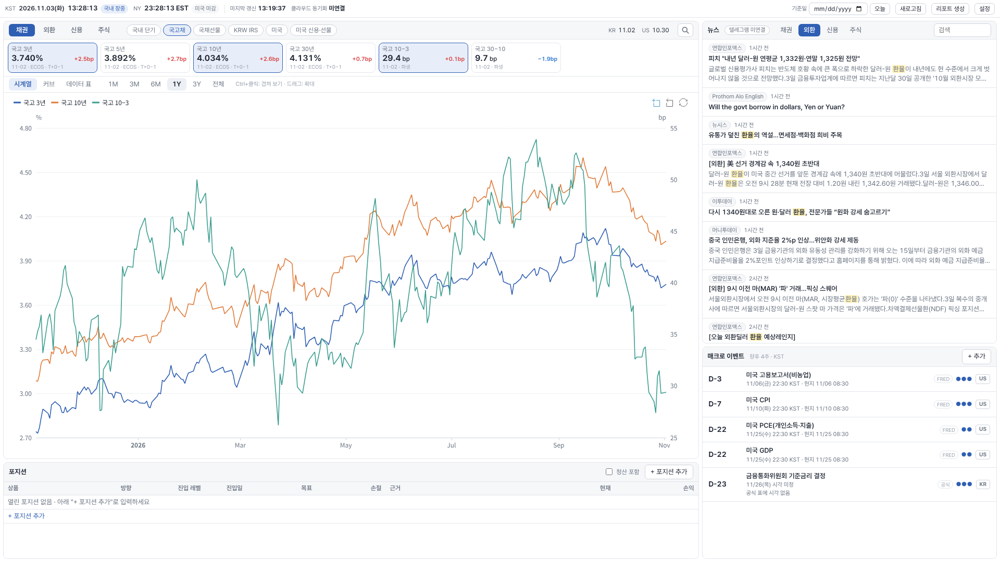
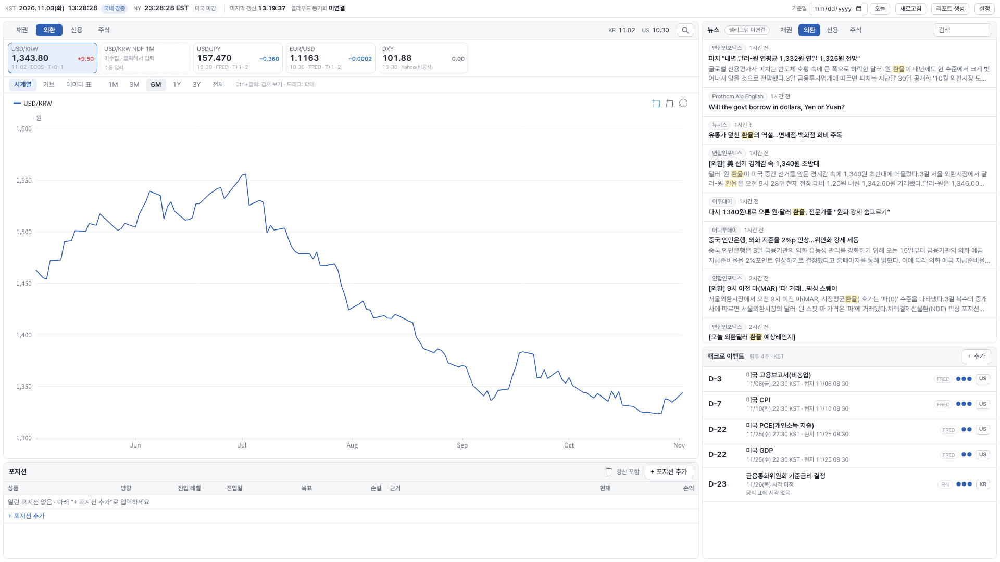
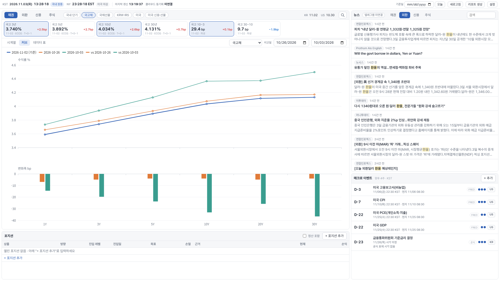
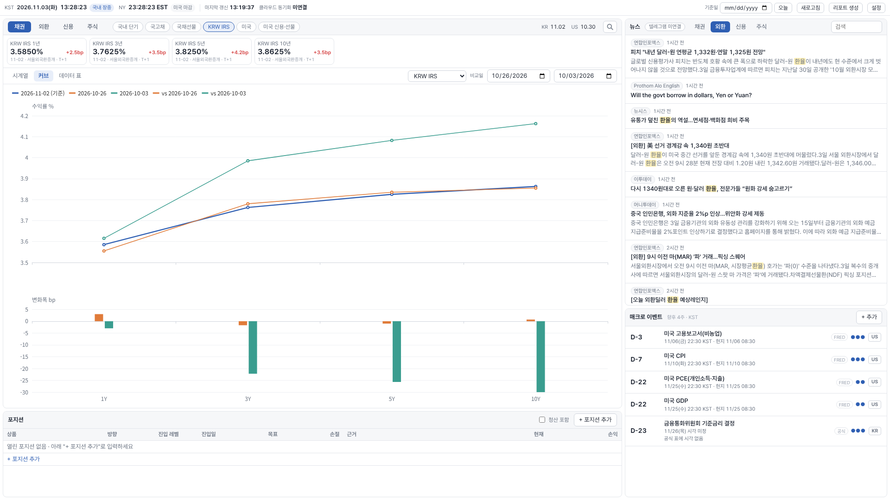
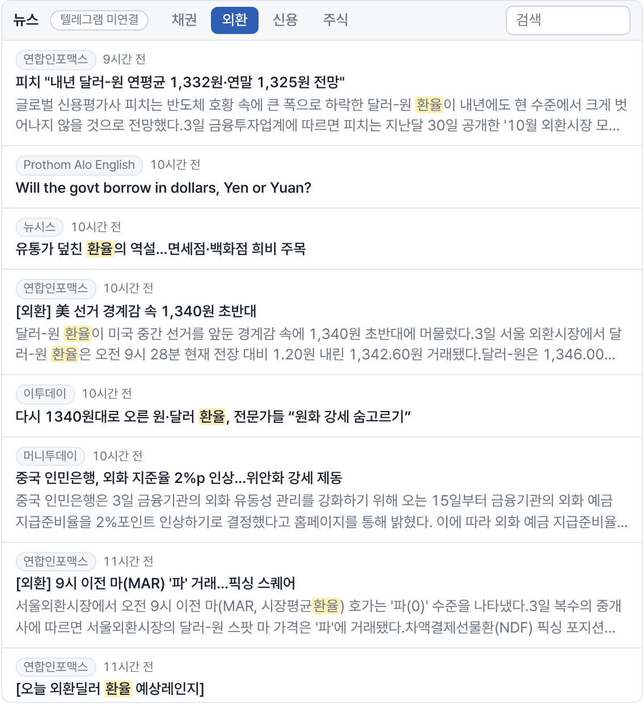
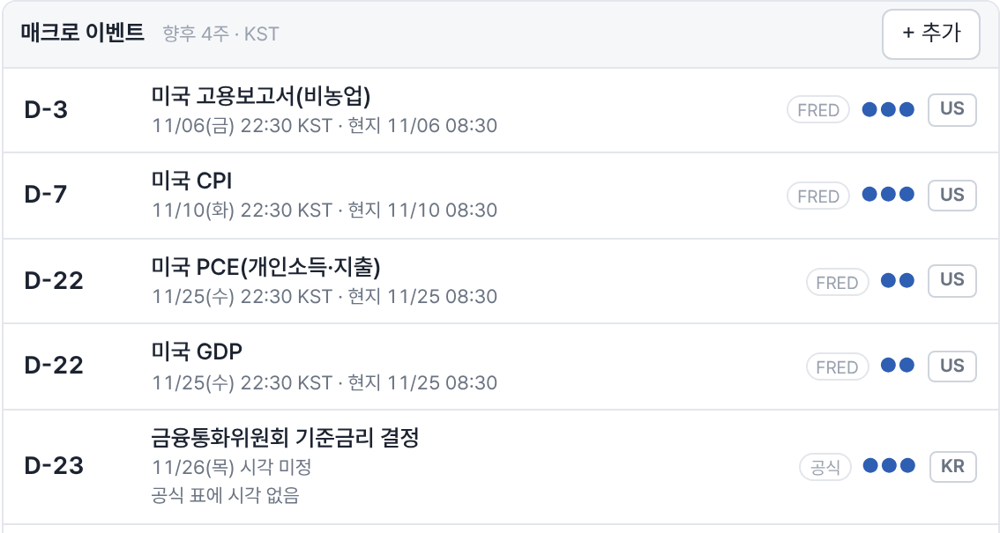
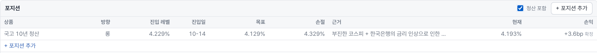
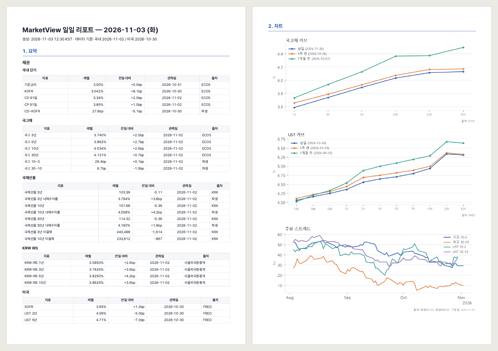
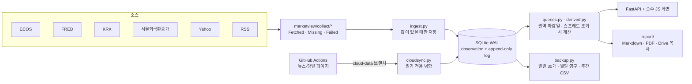

# MarketView

> **English summary.** A personal morning market monitor for KRW and USD rates, FX and credit, built for my own daily routine. Features: a four-tab market screen (rates, FX, credit, equities) with tiles that show level, daily change, observation date and source; curve comparison for KTB, KTB futures, KRW IRS and UST against one week and one month ago; spreads and KTB futures implied yields computed on the fly; news from 24 RSS feeds sorted into tabs with full-text search; a macro calendar (FOMC, BOK, US CPI/payrolls/PCE/GDP) converted to Korean time; a paper-position book with entry, target, stop and rationale, using bond convention for rate P&L; and a daily report (Markdown and PDF) generated every weekday, with catch-up for days the app was off. Data is collected locally every 15 minutes and by GitHub Actions while the laptop is off. About 36,000 daily observations since 2023, 18 daily reports since October 2026.

금리·FX·크레딧 시장을 매일 아침 점검하려고 만든 개인용 마켓 모니터입니다. 국고채, KRW IRS, 국채선물, UST, USD/KRW, 크레딧 스프레드를 한 화면에 모으고, 평일마다 일일 리포트를 남깁니다.



## 구현한 기능

### 1. 시장 화면

| 탭 | 지표 | 함께 보는 스프레드 |
|---|---|---|
| 채권 | 기준금리, KOFR, CD·CP 91일, 국고 3·5·10·30년, 국채선물 3·10·30년(내재수익률·미결제약정), KRW IRS 1~20년, UST 2·5·10·30년, SOFR | 국고 10−3, 국고 30−10, CD−KOFR, UST 10−2, UST 30−10 |
| 외환 | USD/KRW, USD/JPY, EUR/USD, DXY | |
| 신용 | 회사채 AA-·BBB- 3년, 미국 IG·HY OAS | 회사채 − 국고 3년 |
| 주식 | KOSPI, KOSDAQ, S&P 500, NASDAQ, Russell 2000, VIX | |

- 탭은 키보드 1~4로 넘깁니다. 타일마다 레벨, 전일 대비(금리는 bp), 관측일, 출처를 보여 줍니다.
- 타일을 누르면 아래 차트에 겹쳐 그리고, 단위가 다르면 오른쪽 보조축을 씁니다. 기간은 1M부터 전체까지 고릅니다.
- 차트 아래 데이터 표에서 같은 값을 숫자로 보고 CSV로 내보냅니다.
- 기준일을 과거 날짜로 바꾸면 시세와 뉴스가 그날 기준으로 다시 그려집니다.
- 한국과 미국은 게시 시점이 달라, 권역마다 마지막 확정일 기준으로 값을 보여 주고 화면 오른쪽 위에 `KR 11.02 US 10.30`처럼 표시합니다.



### 2. 커브 비교

국고채, 국채선물 내재수익률, KRW IRS, UST 커브를 기준일·1주 전·1개월 전으로 겹쳐 그리고, 아래에 만기별 bp 변화를 막대로 붙였습니다. 비교일은 바꿀 수 있습니다.

| 국고채 커브 | KRW IRS 커브 |
|---|---|
|  |  |

### 3. 스프레드와 국채선물 내재수익률

- 스프레드는 저장하지 않고 화면을 그릴 때 계산합니다. 두 값의 관측일이 같을 때만 계산하고, 하나라도 없으면 0이나 전일 값으로 채우지 않고 "미수집"으로 띄웁니다.
- 국채선물 가격에서 표면금리 5%, 6개월 이표 표준물 기준으로 내재수익률을 역산합니다. 명세는 KRX 공식 상품명세로 대조했습니다. 국채선물은 현금결제라 CTD가 없고, 이 수익률은 기초채권 바스켓의 평균수익률과 비교할 값입니다. 3년물 기준 국고 지표물과의 차이는 10월 초 약 12bp에서 10/30 약 4bp로 줄었습니다.

### 4. 뉴스와 리서치

- RSS 24개(국내 경제지, 연합인포맥스, CNBC, 연준·ECB·한국은행 보도자료 등)를 15분마다 받습니다.
- 제목과 요약의 키워드로 채권·외환·신용·주식 탭에 자동 분류하고, 여러 피드에 같은 기사가 오면 하나만 보여 줍니다. "위안"이 위안부 기사를 외환으로 보내는 식의 오분류는 실제 기사로 찾아 키워드를 고쳤습니다.
- 전체 기간 검색(단어 중간 일치), 읽음 표시, 관심 키워드 하이라이트를 넣었습니다.
- 구독 중인 증권사 리서치 텔레그램 채널을 읽기 전용으로 받아 탭별로 함께 보여 줍니다.



외환 탭 뉴스입니다. "환율"은 관심 키워드로 등록해 노란색으로 표시됩니다.

### 5. 매크로 이벤트

- FOMC, 금통위, 미국 CPI·고용·PCE·GDP 일정을 공식 출처(연준, 한국은행, FRED)에서 받아 D-day로 보여 줍니다.
- 미국 발표 시각은 서머타임과 날짜 넘김을 반영해 한국 시각으로 바꿉니다. 11/6 08:30 ET 고용보고서는 22:30 KST로 표시됩니다.
- 컨센서스, 메모, 중요도는 직접 입력하고, 일정이 다시 동기화돼도 입력한 내용은 남습니다. 국고채 입찰일처럼 자동 소스가 없는 일정은 직접 추가합니다.



출처 배지(FRED, 공식)와 중요도(점 개수), 한국 시각과 현지 시각이 함께 표시됩니다. 금통위는 공식 표에 발표 시각이 없어 "시각 미정"으로 둡니다.

### 6. 페이퍼 포지션

- 상품, 방향, 진입 레벨·날짜, 목표, 손절, 근거를 적어 두면 연결된 시세로 손익을 자동 계산합니다. 손익 단위는 금리 bp, 스프레드 bp, 환율 원, 지수 pt입니다.
- 금리 항목은 채권 관행을 따릅니다. "국고 10년 롱"은 채권 롱이고 금리가 내려야 이익입니다. 스프레드, 가격, 환율은 레벨 기준입니다. 손익, 목표·손절 경고, 리포트 문구가 모두 이 규칙 하나를 따릅니다.
- 청산하면 확정 손익으로 남기고, 모든 변경은 이력으로 쌓입니다.



실제로 기록한 포지션입니다. 국고 10년을 4.229%에 롱으로 잡고 4.193%에 청산해, 금리가 3.6bp 내린 만큼 이익으로 확정됐습니다.

### 7. 일일 리포트

평일 07:30 이후 앱이 켜지면 리포트(Markdown·PDF)를 자동으로 만들고 Google Drive에 복사합니다. 앱이 꺼져 있던 평일은 다음 실행 때 그날 종가 기준으로 따라잡습니다. 지난 날짜 리포트는 그 날짜까지의 종가와 그 시점의 포지션으로 만듭니다.

리포트에는 탭별 요약 표, 차트 6개(국고·UST 커브, 주요 스프레드, 신용 스프레드, FX, 주가지수), 탭별 뉴스와 리서치 채널 제목, 2주 안의 이벤트, 포지션, 데이터 출처와 수집 실패 목록이 들어갑니다. 아래는 2026-11-03 리포트 PDF의 요약 첫 쪽과 차트 쪽입니다.



### 8. 데이터 수집과 보관

- 앱이 켜져 있으면 15분마다 ECOS, FRED, KRX, 서울외국환중개, Yahoo, RSS에서 받습니다. 처음 실행하면 소스마다 가능한 기간(최대 3년)을 채웁니다.
- 노트북이 꺼진 시간에는 GitHub Actions가 같은 수집 코드로 뉴스처럼 나중에 다시 구할 수 없는 것을 받아 두고, 앱이 켜지면 합칩니다.
- 한국 CDS 5Y, USD/KRW NDF 1M처럼 무료 소스가 없는 지표는 화면에서 빼지 않고 "소스 없음 · 수동 입력"으로 띄웁니다. 입력 폼이나 표 붙여넣기로 넣고, 자동 수집이 덮어쓰지 않습니다.
- 매일 DB를 백업하고(일일 30개, 월말 영구, 주간 CSV) Drive에 복사합니다. 실제 DB로 백업 → 복원 → 표별 행 수 비교까지 시험했습니다.

## 운영 기록

2026-11-03 백업 기준입니다.

| 항목 | 값 |
|---|---|
| 수집 실행 | 357회 (성공 343 · 일부 실패 1 · 실패 13), 2026-10-09부터 |
| 지표별 수집 결과 | 9,746건 중 성공 9,733 |
| 일별 관측치 | 36,314행, 57개 지표 (2023-10-10 ~ 2026-11-02) |
| 뉴스 | 41,464건 (제목·링크·요약만 저장) |
| 일일 리포트 | 18건 (자동 11 · 따라잡기 6 · 수동 1) |

## 한계

- 국내 크레딧은 회사채 AA-·BBB- 3년만 자동 수집합니다. 은행채·여전채 같은 섹터 스프레드는 무료 API가 없어 넣지 않았습니다.
- 한국 공휴일 달력이 없어 휴장일 평일에도 리포트가 생성됩니다(값은 직전 영업일).
- 국채선물은 거래량이 가장 많은 월물을 쓰므로 월물 교체일에 가격과 내재수익률이 불연속으로 움직입니다.
- 노트북이 꺼진 동안 뉴스 수집 간격은 무료 GitHub Actions 스케줄 때문에 약 4시간입니다.

## 만든 과정

2026년 8월에 만든 앞 버전을 두 달 쓰면서 불편했던 점을 정리해 새로 만들었습니다. Notion의 Market Notes 두 편(2026년 8~9월)은 앞 버전으로 모은 데이터로 썼습니다. 처음 적은 화면 스케치는 [설계도.txt](설계도.txt), 요구사항 원문은 [MarketView_프롬프트.md](MarketView_프롬프트.md), 설계 문서는 [SPEC.md](SPEC.md)입니다.

<details>
<summary><b>구현 세부 (데이터 소스, 구조, 실행 방법, 검증)</b></summary>

### 데이터 소스

| 소스 | 내용 | 기간 |
|---|---|---|
| ECOS (한국은행) | 기준금리, KOFR, CD·CP 91일, 국고 1~30년, 회사채 AA-·BBB- 3년, USD/KRW | 3년 백필 |
| 서울외국환중개 | KRW IRS 1~20년 Mid | 1년 백필 |
| KRX | 국채선물 3·10·30년 종가·미결제약정, KOSPI·KOSDAQ | 1년 백필 |
| FRED | UST 1개월~30년, SOFR, IG·HY OAS, VIX, S&P 500·NASDAQ | 3년 백필 |
| Yahoo (비공식) | DXY, WTI 근월물, 미국채선물 | 모듈 단위로 격리 |
| 수동 입력 | 한국 CDS 5Y, NDF 1M | 무료 소스 없음 |

API 코드(ECOS 통계표·항목, FRED 시리즈, KRX 상품명)는 실제 호출로 확인한 것만 넣고, 확인 날짜를 `marketview/config/sources.py` 주석에 남겼습니다. 서울외국환중개 IRS 표는 값이 16진 문자코드로 인코딩되어 있어 디코딩 파서를 만들었습니다(`collect/smbs.py`).

### 구조



```
marketview/
├── collect/      소스별 수집기 (로컬과 Actions가 같은 코드를 쓴다)
├── config/       지표 정의, 소스 코드(확인일 주석), 화면 구성, 뉴스 피드, 이벤트 출처
├── ingest.py     일별 수집·백필, 빈 구간 재수집
├── queries.py    타일·시계열·커브 조회, 권역 마감일 (common_close_dates)
├── derived.py    파생 스프레드 레지스트리 (관측일이 같은 값끼리만 계산)
├── futures.py    국채선물 내재수익률
├── events.py     이벤트 동기화, 현지 시각 → KST
├── news.py       뉴스 분류·중복 제거·검색
├── userdata.py   이벤트·포지션 (append-only 이력, profit_sign)
├── report/       일일 리포트 생성, 자동 생성·따라잡기
├── backup.py     VACUUM INTO 스냅샷 → 무결성 검사 → gzip, 복원
└── cloud*.py     Actions 수집과 로컬 병합
migrations/       001~005 SQL
tests/            253개, 네트워크 없이 저장된 응답과 임시 DB로 돈다
```

### 실행 방법

Windows, Python 3.14 (테스트는 3.13에서도 통과). Node·ORM·빌드 단계는 없습니다.

```
py -3.14 -m venv .venv
.venv\Scripts\python -m pip install -r requirements.txt
copy .env.example .env          # ECOS·FRED·KRX 키. 비어 있으면 그 소스만 건너뛴다
.venv\Scripts\python -m uvicorn marketview.app:app --host 127.0.0.1 --port 8790
```

`127.0.0.1:8790`을 엽니다. 바탕화면 아이콘은 `scripts\install_shortcut.ps1`로 만듭니다.

```
.venv\Scripts\python -m pytest -q
.venv\Scripts\python -m marketview.report 2026-11-02     # 리포트 수동 생성
.venv\Scripts\python -m marketview.backup all             # 백업 수동 실행
```

백업·복원 절차와 보관 규칙은 SPEC.md §10, 클라우드 수집 구조는 §6·§11에 있습니다.

### 공개본에서 뺀 것

- API 키(`.env`), DB·리포트·백업 파일, 텔레그램 세션.
- 구독 중인 텔레그램 채널 목록(`config/telegram.py`는 비워 두었습니다).
- Actions 스케줄. 이 저장소에서는 수동 실행만 남겼고, 실제 수집은 비공개 저장소에서 돕니다.
- 개인 환경 경로와 운영 기록.

### 개발 방식과 검증

화면 스케치와 요구사항은 직접 정했고, 설계 문서와 운영 규칙([CLAUDE.md](CLAUDE.md))을 먼저 쓴 뒤 Claude Code로 단계별(Phase 0~8)로 구현했습니다. 단계마다 서버 로그, 스크린샷, 생성된 리포트로 동작을 확인한 뒤 다음 단계로 넘어갔고, 화면 구성·기준 날짜·포지션 방향 같은 결정은 SPEC.md §13에 날짜와 함께 남겼습니다.

- 소스 코드는 실제 호출로 확인한 것만 넣고 확인일을 주석에 남겼습니다.
- 수집기·파서 테스트는 저장된 응답으로 네트워크 없이 돕니다. 병합은 같은 입력을 두 번 넣어도 결과가 같은지, 수동 입력값을 자동 수집이 덮지 않는지 테스트합니다.
- 공개 전에 저장소 전체에서 API 키·토큰·개인 경로를 검색했습니다.

</details>

## License

MIT. 번들한 서드파티 파일은 각자의 라이선스를 따릅니다: Apache ECharts (Apache-2.0, `marketview/static/vendor/`), Pretendard (SIL OFL 1.1, `marketview/static/fonts/`).
