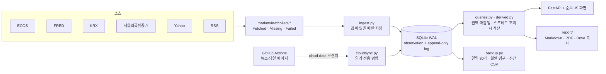

# MarketView

> **English summary.** A single-user market viewer for KRW and USD rates, FX and credit. It collects KTB yields, KRW IRS, KTB futures, UST, USD/KRW and credit spreads from public APIs (Bank of Korea ECOS, FRED, KRX, Seoul Money Brokerage), shows every number with its source and observation date, and writes a daily report (Markdown and PDF) each weekday. The main design problem was data timing: sources publish on different lags, so the screen aligns values to each region's last confirmed close instead of mixing days. FastAPI, SQLite, vanilla JS, GitHub Actions for collection while the laptop is off. 253 tests.

국고채·KRW IRS·국채선물·UST·USD/KRW·크레딧을 한 화면에 모으고, 평일마다 일일 리포트를 자동으로 남기는 1인용 마켓 뷰어입니다. 숫자마다 출처와 관측일을 붙여 서로 다른 날의 값이 한 줄에 섞이지 않게 했습니다.


## 왜 만들었나

아침마다 금리·FX 숫자를 확인하다 보면 같은 화면에 오늘 값과 며칠 전 값이 섞입니다. ECOS 국고채는 당일, KRX 국채선물은 T+1, FRED 미 국채는 1~3일 뒤에 게시되기 때문입니다. 그대로 비교하면 스프레드와 전일 대비가 조용히 틀립니다. 게시 시각이 제각각이고 자주 실패하는 무료 소스로, 틀린 숫자를 띄우지 않으면서 매일 같은 기준의 기록을 쌓는 것이 목표였습니다.

이 프로젝트의 앞 버전(ficc-desk, 2026-08)을 두 달 쓰면서 불편했던 점을 정리해 새로 만들었습니다. 처음 적은 화면 스케치는 [설계도.txt](설계도.txt), 요구사항 원문은 [MarketView_프롬프트.md](MarketView_프롬프트.md), 설계 문서는 [SPEC.md](SPEC.md)입니다.

## 화면

| 국고채 커브 (기준일 / 1주 전 / 1개월 전, 아래는 bp 변화) | KRW IRS 커브 |
|---|---|
|  |  |

- 탭: 채권·외환·신용·주식 (키 1~4). 타일을 누르면 아래 차트에 겹쳐 그리고, 단위가 다르면 오른쪽 보조축을 씁니다.
- 하위 뷰: 시계열 / 커브(비교일 2개) / 데이터 표(CSV 내보내기).
- 오른쪽: 뉴스(RSS, 탭별 분류·검색), 매크로 이벤트(FOMC·금통위·미 지표, 미국 시각은 KST로 변환).
- 아래: 페이퍼 포지션(진입·목표·손절·근거, 손익 자동 계산).

## 데이터

| 소스 | 내용 | 기간 |
|---|---|---|
| ECOS (한국은행) | 기준금리, KOFR, CD·CP 91일, 국고 1~30년, 회사채 AA-·BBB- 3년, USD/KRW | 3년 백필 |
| 서울외국환중개 | KRW IRS 1~20년 Mid | 1년 백필 |
| KRX | 국채선물 3·10·30년 종가·미결제약정, KOSPI·KOSDAQ | 1년 백필 |
| FRED | UST 1개월~30년, SOFR, IG·HY OAS, VIX, S&P 500·NASDAQ | 3년 백필 |
| Yahoo (비공식) | DXY, WTI 근월물, 미국채선물 | 모듈 단위로 격리 |
| 수동 입력 | 한국 CDS 5Y, NDF 1M | 무료 소스 없음 |

API 코드(ECOS 통계표·항목, FRED 시리즈, KRX 상품명)는 실제 호출로 확인한 것만 넣고, 확인 날짜를 `marketview/config/sources.py` 주석에 남겼습니다. 무료 소스가 없는 항목도 숨기지 않고 "소스 없음 · 수동 입력"으로 띄웁니다.

## 설계에서 내린 판단

**화면의 기준 날짜.** 소스마다 최신 값을 쓰면 날짜가 다른 숫자끼리 비교됩니다. 한국·미국을 한 날짜로 맞추면 늦게 게시되는 미국에 맞춰 한국의 최신 값을 버리게 됩니다. 그래서 권역별 마감일을 씁니다. 한국은 ECOS·KRX·서울외국환중개, 미국은 FRED·Yahoo 기준으로 각각 확정된 마지막 날이고, 그보다 오래된 값은 날짜를 굵게 표시합니다(`queries.common_close_dates`).

**결측과 파생값.** 값을 못 받으면 행을 만들지 않고 "미수집"으로 띄웁니다. 0이나 전일 값으로 채우면 스프레드가 조용히 틀리기 때문입니다. 스프레드는 저장하지 않고 조회할 때 계산하며, 구성 값의 관측일이 같은 날짜끼리만 계산합니다(`derived.py`). 덮어쓰기는 append-only 로그에 이전 값과 함께 남깁니다.

**KRW IRS.** 서울외국환중개 IRS 표의 Mid를 씁니다. 값이 16진 문자코드로 인코딩되어 있어 디코딩 파서를 만들었고, 과거 날짜 조회가 되는 것을 확인해 1년치를 백필했습니다(`collect/smbs.py`).

**국채선물 내재수익률.** 표면금리 5%·6개월 이표 표준물의 이론가 식으로 선물 가격에서 수익률을 역산합니다(`futures.py`, KRX 공식 상품명세로 대조). 국채선물은 현금결제라 CTD가 없고, 내재수익률은 기초채권 바스켓의 평균수익률과 비교할 값입니다. 국고 지표물과는 바스켓 만기 구성과 캐리만큼 차이가 나며, 3년물 기준 이 차이가 10월 초 약 12bp에서 10/30 약 4bp로 줄었습니다.

**포지션 손익의 방향.** 금리(% 단위) 항목은 채권 관행을 따릅니다. 롱 = 채권 롱 = 금리 하락 시 이익입니다. 스프레드·가격·환율은 레벨 기준입니다. 금리 항목을 레벨로 두면 "국고 10년 롱"이 금리 상승 베팅으로 읽히기 때문입니다. 손익, 목표·손절 경고, 리포트 문구가 한 규칙(`userdata.profit_sign`)을 따릅니다.

**노트북이 꺼져 있을 때.** 일별 시세는 소스가 과거를 보관하므로 앱이 켜질 때 로컬이 백필합니다. 나중에 다시 구할 수 없는 것(뉴스, 당일 값만 보이는 페이지)만 GitHub Actions가 같은 수집 코드(`marketview/collect/`)로 받아 별도 브랜치에 커밋하고, 로컬 앱이 읽기 전용으로 병합합니다(`cloudsync.py`, 같은 파일을 여러 번 합쳐도 결과가 같다).

## 구조



```
marketview/
├── collect/      소스별 수집기 (로컬과 Actions가 같은 코드를 쓴다)
├── config/       지표 정의, 소스 코드(확인일 주석), 화면 구성, 뉴스 피드, 이벤트 출처
├── ingest.py     일별 수집·백필, 빈 구간 재수집
├── queries.py    타일·시계열·커브 조회, 권역 마감일
├── derived.py    파생 스프레드 레지스트리
├── futures.py    국채선물 내재수익률
├── userdata.py   이벤트·포지션 (append-only 이력)
├── report/       일일 리포트 생성, 자동 생성·따라잡기
├── backup.py     VACUUM INTO 스냅샷 → 무결성 검사 → gzip, 복원
└── cloud*.py     Actions 수집과 로컬 병합
migrations/       001~005 SQL
tests/            253개, 네트워크 없이 저장된 응답과 임시 DB로 돈다
```

## 운영 수치

2026-11-03 백업 기준입니다.

| 항목 | 값 |
|---|---|
| 로컬 수집 실행 | 357회 (ok 343 · partial 1 · failed 13), 2026-10-09 ~ |
| 필드별 수집 결과 | 9,746건 중 ok 9,733 |
| 일별 관측치 | 36,314행, 57개 지표 (2023-10-10 ~ 2026-11-02) |
| 뉴스 | 41,464건 (제목·링크·요약만 저장) |
| 일일 리포트 | 18건 (자동 11 · 따라잡기 6 · 수동 1) |

## 한계

- 국내 크레딧은 회사채 AA-·BBB- 3년만 자동 수집합니다. 은행채·여전채 같은 섹터 스프레드는 무료 API가 없어 넣지 않았습니다.
- 한국 공휴일 달력이 없어 휴장일 평일에도 리포트가 생성됩니다(값은 직전 영업일).
- 국채선물은 거래량 최대 월물을 쓰므로 월물 교체일에 가격과 내재수익률이 불연속으로 움직입니다.
- 무료 GitHub Actions 스케줄이 설계보다 적게, 늦게 돌아 노트북이 꺼진 동안 뉴스 수집 간격이 약 4시간입니다.

## 실행 방법

Windows, Python 3.14 (테스트는 3.13에서도 통과). Node·ORM·빌드 단계는 없습니다.

```
py -3.14 -m venv .venv
.venv\Scripts\python -m pip install -r requirements.txt
copy .env.example .env          # ECOS·FRED·KRX 키. 비어 있으면 그 소스만 건너뛴다
.venv\Scripts\python -m uvicorn marketview.app:app --host 127.0.0.1 --port 8790
```

`127.0.0.1:8790`을 엽니다. 처음 실행하면 소스별로 가능한 기간을 백필합니다. 바탕화면 아이콘은 `scripts\install_shortcut.ps1`로 만듭니다.

```
.venv\Scripts\python -m pytest -q
.venv\Scripts\python -m marketview.report 2026-11-02     # 리포트 수동 생성
.venv\Scripts\python -m marketview.backup all             # 백업 수동 실행
```

백업·복원 절차와 보관 규칙은 SPEC.md §10, 클라우드 수집 구조는 §6·§11에 있습니다.

## 공개본에서 뺀 것

- API 키(`.env`), DB·리포트·백업 파일, 텔레그램 세션.
- 구독 중인 텔레그램 채널 목록(`config/telegram.py`는 비워 두었습니다).
- Actions 스케줄. 이 저장소에서는 수동 실행만 남겼고, 실제 수집은 비공개 저장소에서 돕니다.
- 개인 환경 경로와 운영 기록.

## 개발 방식

화면 스케치와 요구사항(무엇을 볼지, 어떤 기준으로 비교할지)은 직접 정했고, 설계 문서와 운영 규칙([CLAUDE.md](CLAUDE.md))을 먼저 쓴 뒤 Claude Code로 단계별(Phase 0~8)로 구현했습니다. 단계마다 서버 로그·스크린샷·생성된 리포트로 동작을 확인한 뒤 다음 단계로 넘어갔고, 화면 구성·기준 날짜·포지션 방향 같은 결정은 SPEC.md §13에 날짜와 함께 남겼습니다.

검증은 이렇게 했습니다.

- 소스 코드는 실제 호출로 확인한 것만 넣고 확인일을 주석에 남겼습니다.
- 수집기·파서 테스트는 저장된 응답으로 네트워크 없이 돕니다. 병합은 같은 입력을 두 번 넣어도 결과가 같은지(멱등), 수동 입력값을 자동 수집이 덮지 않는지 테스트합니다.
- 백업은 실제 DB로 백업 → 복원 → 표별 행 수 비교까지 해 봤습니다.
- 공개 전에 저장소 전체에서 API 키·토큰·개인 경로를 검색했습니다.

## License

MIT. 번들한 서드파티 파일은 각자의 라이선스를 따릅니다: Apache ECharts (Apache-2.0, `marketview/static/vendor/`), Pretendard (SIL OFL 1.1, `marketview/static/fonts/`).
